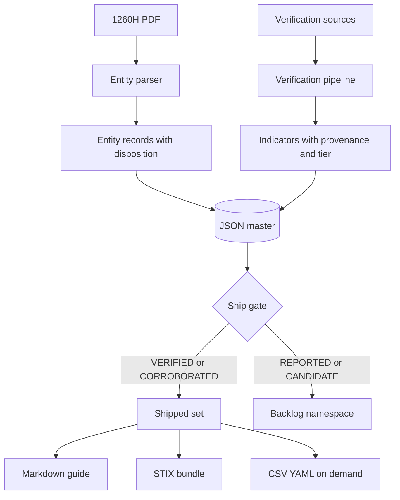
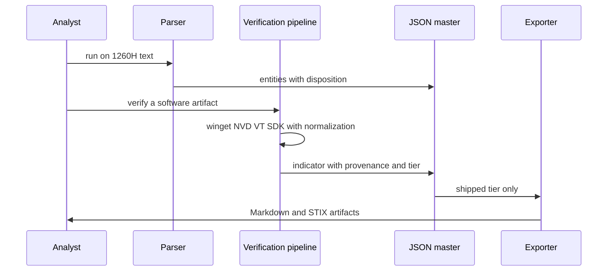

# ARCHITECTURE — threat_hunt_china_entities

- Author: Cutaway Security (Don C. Weber)
- Date: 2026-06-30
- Status: Phase 7 draft (pre second multi-AI validation)
- Companion docs: VISION.md, REQUIREMENTS.md, SUCCESS_CRITERIA.md, DISCOVERY_NOTES.md,
  20260630_1260h_software_threat_hunt_RESEARCH.md, verification_pipeline_notes.md, stix_modeling_notes.md

This is a design-rationale document. It explains *why* each decision was made. Code-level "how" lives
in module headers and PLAN.md. Diagrams support the prose; they do not replace it.

---

## §1 The shape of the system

Most "threat intel datasets" are a pile of indicators someone asserts are real. This system is the
opposite: a **single nested truth store** in which an indicator cannot exist without the software,
the company, the citation, and the confidence tier that justify it — and from which every shareable
artifact is *generated*, never hand-maintained. The product is not the verification pipeline and not
the STIX bundle; it is a **constrained, provenance-bearing dataset** plus the method to keep it
honest. Two failure modes from the quarantined CoPilot run drive the whole design: (1) unsourced
indicators, and (2) orphaned attribution (`UNKNOWN/UNKNOWN`). The architecture is *designed* to make
both structurally impossible — but that property holds only **once the schema, nested master, and gate
scripts exist** (all `[planned]` below). Today only the entity parser is built; the structural
guarantees are a design intention the v0.1/v0.2 slices realize, not a present-repository fact. <!-- AI
review 20260630-085540 (anthropic+openai HIGH): do not describe a future property as already true. -->

What makes this system different from a generic indicator catalog: provenance is a first-class,
mandatory property; the data is deliberately kept at **recognition-grade altitude** (named,
version-independent artifacts — no hashes, no version pins); and "coverage" means a justified
**disposition** for every entity, not a host artifact for each.



---

## §2 Decision: a single nested JSON master is the source of truth

**Decision.** Store everything in one JSON document nested entity → software → indicator, with the
delisted list and a separate backlog namespace alongside.

**Alternative considered.** The prior run's relational CSV set (companies, software, indicators,
attribution as separate files).

**Why.** (1) Nesting makes orphaned attribution impossible: an indicator is physically a child of its
software, which is a child of its company — there is no way to produce the `UNKNOWN/UNKNOWN` linkage
that sank the prior run. (2) One text file diffs cleanly in git, validates against one schema, and is
the single thing every export reads, so there is no cross-file drift. (Satisfies DR-01, AR-03, NFR-01.)

**How it could be wrong + mitigation.** A single large file can get unwieldy and merge-conflict-prone.
Mitigation: the file is machine-generated/edited through tooling, not hand-edited; it stays well under
sizes where JSON tooling struggles (hundreds of entities, not millions); the schema (DR-07) catches
structural breakage on every write.

---

## §3 Decision: master-and-exports — every other format is a generated projection

**Decision.** Markdown, STIX, CSV, and YAML are deterministic projections generated from the master.
None is hand-maintained; Markdown and STIX are standing outputs, CSV/YAML are on-demand.

**Alternative considered.** Maintain each consumer format directly (the instinct that produced file
sprawl).

**Why.** (1) The hand-authored summary is exactly what burned the prior run; generation removes the
human drift. (2) Provenance and tier filtering can be enforced once, in the exporter, rather than
re-checked per format. (Satisfies AR-01, FR-08/09, D4.)

**How it could be wrong + mitigation.** A generator bug could corrupt every export at once.
Mitigation: round-trip/validation gates (TR-03, TSC-05) run on each build; STIX validates against
2.1; the master is the recoverable source.

---

## §4 Decision: a tiered verification pipeline with source→claim-type binding

**Decision.** Ground each artifact through tiered sources, and credit each source only for the claim
it actually proves: winget → installer filename/ProductCode/ARP; NVD CPE → canonical naming;
VirusTotal → binary↔vendor code-signer linkage and embedded-library detection; vendor SDK/user PDFs →
DLL/service/install-path names; Playwright → render JS/WAF-blocked vendor portals.

**Alternative considered.** A single source (or trusting the vendor narratives) and a flat
"confidence number."

**Why.** (1) No single source proves a whole indicator — a VT signer proves provenance of a binary,
not its registry key; binding sources to claim types prevents the overclaim the panel flagged.
(2) The tiers route around real obstacles (winget gaps, WAF blocks) without lowering the bar.
(Satisfies AR-02, IR-01..05, DR-02/02a.)

**How it could be wrong + mitigation.** External sources can be stale, wrong, or unavailable; VT is
point-in-time and not an enumerator. Mitigation: VERIFIED requires ≥2 classes incl. one
vendor-official; VT supports attribution/CORROBORATED, never coverage; a staleness window (TSC-04)
forces re-fetch; every value carries `source_url`, `source_tier`, `date_verified`, `verifier_tool`.

---

## §4a Decision: indicators are assembled from atomic typed claims

**Decision.** Insert an intermediate **evidence layer**: a source fetch produces typed **claim**
objects — `binary_signer`, `installer_filename`, `arp_publisher`, `product_naming`, `sdk_dll_name`,
`service_name`, `install_path`, `registry_key` — each recording what it proves, its source class, and
its source URL. An indicator is *assembled* from claims by rules that forbid unsupported promotions;
the schema, not operator judgment, enforces which claim types a given indicator type and tier require.

**Alternative considered.** Keep a flat indicator record and enforce DR-02a by documentation/policy.

**Why.** (1) DR-02a ("each source proves only its claim type") is only as strong as its enforcement;
a flat record lets an implementer mark a `REGISTRY_KEY` VERIFIED on a `binary_signer` claim — exactly
the overclaim the panel warned of. Typed claims make that promotion structurally impossible.
(2) It makes the verification log and the ETAC validation trail self-describing: every indicator
decomposes into the claims (and sources) that justify it. (Satisfies DR-02a, AR-02; openai pass-2.)

**How it could be wrong + mitigation.** More schema complexity than a flat record. Mitigation: the
claim vocabulary is small and closed; the added structure is the whole point — it is what prevents the
prior run's failure rather than merely discouraging it.

---

## §5 Decision: confidence tiers + structural shipped/backlog separation enforced by gates

**Decision.** Every indicator carries a tier (VERIFIED/CORROBORATED/REPORTED/CANDIDATE). Only the top
two ship. Backlog (REPORTED/CANDIDATE, including the quarantined CoPilot values) lives in a separate
namespace, and a tier-leak gate plus a re-fetch gate run before any ship.

**Alternative considered.** A review-only "we'll be careful" policy with one combined list.

**Why.** (1) The entire value proposition ("ETAC validates, not rebuilds") collapses if one
fabricated-looking value reaches ETAC; policy is not enough — leakage must be structurally impossible.
(2) Separating the backlog namespace means an export bug cannot pull CANDIDATE into a bundle (defense
in depth beyond the gate). (Satisfies DR-03, DR-08, TSC-02/03/04.)

**How it could be wrong + mitigation.** Gates can be bypassed if not run. Mitigation: gates are
runnable scripts wired into the build/pre-ship path, not manual checklists; the load-bearing
acceptance clause (SUCCESS_CRITERIA) makes a real fetch the definition of "verified."

---

## §6 Decision: coverage is a disposition, not an artifact harvest

**Decision.** Every entity gets one of: `indicators_identified`, `software_no_verified_indicators`,
`server_or_linux_only`, `hardware_or_firmware_only`, `no_windows_software_found`,
`candidate_pending_verification` — each with a one-line justification.

**Alternative considered.** Treat "coverage" as finding host artifacts for all 80 parents.

**Why.** (1) Most listed entities (aerospace, shipping, nuclear, chemical) produce no
Windows-installable software at all; pretending otherwise invites fabrication. (2) A justified
disposition is more honest and more useful to ETAC and admins than a forced indicator. (Satisfies
FR-05; openai review.)

**How it could be wrong + mitigation.** A too-quick `none` could miss real software. Mitigation: the
disposition carries a justification and a source where applicable; re-runnable as research deepens.

---

## §7 Decision: recognition-grade altitude — no hashes, no version pins, normalize to stable form

**Decision.** Indicators are named, version-independent artifacts. Hashes and version-pinned strings
are forbidden as indicators and in exports; a hash used during verification lives only in the
verification log. Version-specific source outputs are normalized to the stable form before becoming
an indicator (`WeChatSetup_3.9.12.57_x64.exe` → `wechat.exe`).

**Alternative considered.** A forensic IOC feed with hashes and per-version detail.

**Why.** (1) Hashes/versions are point-in-time and unstable (research §4.3, Pyramid of Pain) — they
identify one instance and miss the rest, the opposite of what a higher-level inventory hunt needs.
(2) Keeping altitude high is what makes the data durable across vendor updates and the annual list
refresh. (Satisfies DR-09, DR-10, D8.)

**How it could be wrong + mitigation.** Some genuinely useful signal is version-bound. Mitigation: it
is explicitly out of scope here and re-entry is a separate forensic effort, not creep into this one.

---

## §8 Decision: STIX as a non-malware projection; presence_class distinguishes product vs SDK

**Decision.** Project to STIX 2.1 as `software` SCO + `identity` (vendor) + `indicator` +
`relationship`, with **non-malware semantics**, never the `malware` SDO. Every indicator records
`presence_class`: `product_installed` vs `sdk_embedded`. **The CPE version field is wildcarded and the
SCO `version` property is omitted** so no version-pinned value enters the export (DR-09/DR-10) — an
ADR records this. The `indicator_types` value (`anomalous-activity` vs `benign`) is confirmed with
ETAC before the v0.3 freeze, not fixed now. <!-- AI review 20260630-085540 (anthropic CRITICAL): the
STIX skeleton had embedded version 4.2.1 + version-pinned cpe, contradicting the altitude rule. -->

**Alternative considered.** Model as `malware`/`malicious-activity` (the default reflex for a "China
threat" dataset).

**Why.** (1) A 1260H designation is corporate affiliation, not a malware finding (*DJI v. DoD*);
mislabeling lawful software as malicious could trigger auto-blocking downstream — the single most
damaging possible error. (2) `sdk_embedded` means vendor *code* is present, not the vendor *product*;
conflating them overclaims. (Satisfies FR-08, FR-03a, SR-03; research §5.)

**How it could be wrong + mitigation.** `anomalous-activity` may not match ETAC's ingestion
expectation. Mitigation: it is held as an open question to confirm with ETAC before freezing
(§N+8.4); the master is format-agnostic so re-projection is cheap.

---

## §9 Cross-cutting concerns

- **Observability / verification log.** Every verification attempt appends to an immutable log
  (artifact, source_url, fetch timestamp, tool, result, extracted-then-normalized value, optional
  hash-as-provenance). This is the ETAC validation trail and the home for any hash. (OR-01/02.)
- **Error handling.** Each source has defined failure semantics (winget 404 → other tier; VT 401 →
  STOP; WAF block → Playwright → SDK PDF → CANDIDATE). A source failure downgrades confidence; it
  never silently fabricates.
- **Security.** Read-only against external sources; never install/execute target software (SR-02).
  Keys via a keys-dir/env contract, never committed, never a verbatim personal path in docs (SR-01).
  Quarantined inputs carry machine-readable UNTRUSTED banners; anything traceable to the quarantine
  starts life as CANDIDATE with no inherited provenance.
- **Trust boundaries (AI review 20260630-085540).** The Playwright tier **executes untrusted
  vendor/WAF-served JavaScript** in real Chromium — that is a trust boundary, not "just rendering."
  Run it sandboxed, pin Chromium (149), and never let rendered DOM text flow into the master without
  passing back through the claim/verification layer. Model source **deception**, not just outage:
  SEO-poisoned vendor pages, a winget manifest repointed to a changed location, crowd-influenced VT
  data. Each source class carries an integrity assumption and a cross-check, not only error semantics.
- **Cost.** Not load-bearing (NFR-03). Only levers: NVD rate-limit back-off, VT quota, Playwright
  fragility — all non-blocking for the early tiers.

---

## §10 Module layout

```
threat_hunt_china_entities/
  CLAUDE.md                      operating rules (Phase 9)
  README.md                      human orientation (Phase 9)
  .gitignore                     *.key.txt first line
  background/                    1260H PDF + URL; _quarantine_untrusted_copilot/ (UNTRUSTED)
  data/
    source_extraction/           parse_1260h.py + layout text + entities_1260h.json (DONE)
    schema/                      master JSON schema (v0.1)            [planned]
    master/                      entities.json nested master         [planned]
    backlog/                     REPORTED/CANDIDATE namespace         [planned]
    logs/                        verification log (provenance trail)  [planned]
  pipeline/                      verification tooling (tiered)        [planned v0.2]
    sources/                     winget, nvd, virustotal, playwright, pdf adapters
    verify.py                    orchestrates source->claim->tier
    gates.py                     schema, tier-leak, re-fetch, staleness checks
  exporters/                     markdown, stix, csv, yaml (from master) [planned v0.3]
  guide/                         threat-hunt guide w/ PowerShell examples [planned v0.3]
  claude-dev/                    planning docs + .ai-reviews/
  .venv/                         Playwright/Chromium (gitignored)
```

**Components**

| Component | Purpose | Technology |
|---|---|---|
| Entity parser | 1260H PDF → verified entity records (count-gated) | Python 3 + pdftotext |
| JSON master + schema | single nested source of truth | JSON + JSON Schema |
| Verification pipeline | ground artifacts via tiered sources; assign tier | Python 3, curl/requests, Playwright |
| Gates | schema / tier-leak / re-fetch / staleness enforcement | Python 3 |
| Exporters | deterministic Markdown / STIX / CSV / YAML projections | Python 3 |
| Hunt guide | admin summary + runnable PowerShell examples | Markdown + PowerShell |
| Verification log | immutable provenance trail (ETAC validation evidence) | JSONL |

**Technology Stack**

| Layer | Technology | Version |
|---|---|---|
| Language | Python | 3.12 |
| PDF extraction | poppler pdftotext | system |
| Source fetch | curl / jq (and Python stdlib) | system |
| Headless render | Playwright + Chromium | playwright 1.x / chromium 149 |
| Attribution | VirusTotal API | v3 |
| Naming | NIST NVD CPE API | 2.0 |
| Package metadata | winget-pkgs | GitHub raw/API |
| Exchange | STIX | 2.1 |

---

## §11 Configuration

- `KEYS_DIR` — env var naming the directory of `*.key.txt` files (configured per environment; no
  verbatim personal path in docs, SR-01). VirusTotal key resolved as `${KEYS_DIR}/virustotal.key.txt`.
  No key value ever in the repo or docs.
- Verification source endpoints (winget raw/API, NVD CPE, VT v3) are constants with documented
  contracts (REQUIREMENTS IR-01..05).
- Staleness window (default 180 days) for TSC-04 re-verification.
- Parser input path: CLI arg, default repo-local `data/source_extraction/1260h_pdftotext_layout.txt`.

---

## §12 Data flow (dominant path)



---

## §13 Constraints

- Windows host artifacts first; Linux/server second; OT/ICS passive-only (no active scanning).
- Notice-only: no installation of target software in any environment (SR-02).
- Indicator types limited to FILE_NAME/FILE_PATH/FOLDER_PATH/REGISTRY_KEY/SERVICE_NAME/DLL_NAME/
  PROCESS_NAME; no hashes, no version pins (DR-09/10).
- `Win32_Product` is forbidden in hunt examples (MSI reconfiguration hazard; research §4.2).
- STIX must avoid `malware` SDO and `malicious-activity` indicator type.
- Mermaid diagrams use the portable subset (no edge-label punctuation, no special chars in nodes).

---

## §14 Failure modes

| Failure | Surfaced by | Recovery |
|---|---|---|
| PDF layout drift on annual rerun | parser count gate exits non-zero | re-verify parse vs PDF before trusting output |
| Vendor portal WAF/JS block | source returns 403 / empty | Playwright render → SDK PDF → CANDIDATE |
| VT/NVD unavailable or rate-limited | API error / 429 | back-off; downgrade tier; never fabricate |
| Version-specific value reaches indicator | normalization + DR-10 check | normalize to stable form or reject |
| CANDIDATE leaks toward export | tier-leak gate (TSC-03) + separate namespace | gate fails build; fix before ship |
| Stale citation | staleness window (TSC-04) | flag for re-fetch; block ship until refreshed |

---

## §15 Version boundary

- **v0.1** entity parser (done) + JSON schema + nested master (entities only) + count/diff checks.
- **v0.2** Tier-1 pipeline (winget/NVD/VT) + 3–5 verified seed + backlog namespace + tier-leak/
  re-fetch gates + Markdown-from-master. First ETAC-capable artifact.
- **v0.3** STIX exporter + hunt guide w/ PowerShell + STIX/round-trip validation + CSV/YAML on demand.
- **v1.0** Tier-2/3 hard vendors (Hikvision/Dahua SDK DLLs) + annual-rerun runbook + ETAC handoff.

---

## §16 Open questions

1. STIX `indicator_types` final value (`anomalous-activity` vs `benign`) — confirm with ETAC ingestion.
2. Whether ETAC has internal/unpublished 1260H work — confirm with the contact (dedup covers public).
3. Normalization rules for conflicting vendor names across sources (winget vs NVD vs vendor) — define
   a canonical-name resolver in the schema.
4. SDK-DLL verification path for Hikvision/Dahua — headless render of SDK manual PDFs vs VT signer of
   known binaries; resolve in v1.0.
5. Exact schema for the verification log (JSONL fields) — finalize at v0.2.
